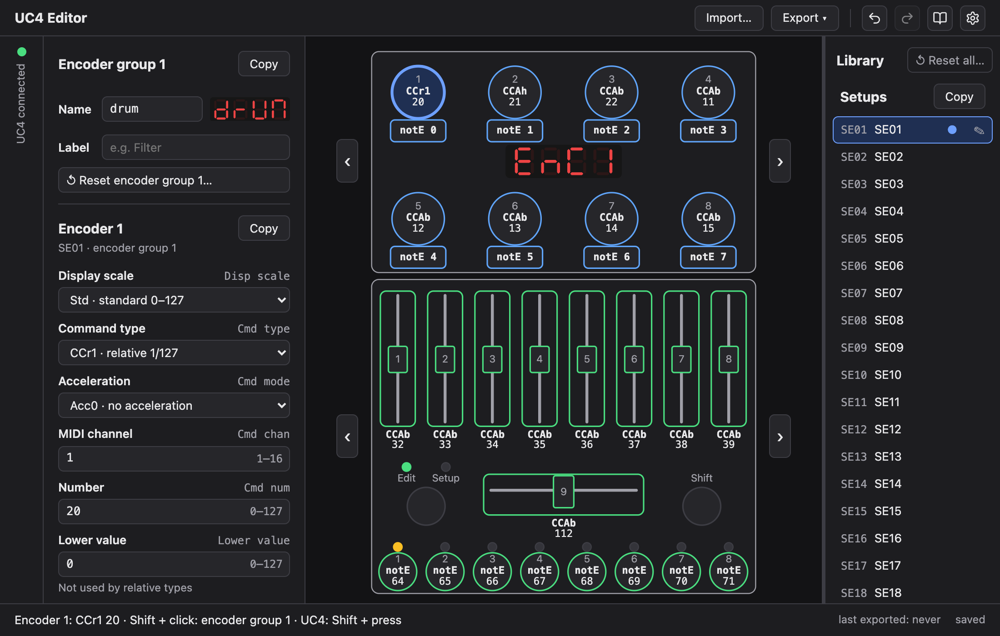

# UC4 Editor

> [!IMPORTANT]
> **Independent project, not supported by Faderfox.** The UC4 Editor is an unofficial, community-developed editor.
> It is not affiliated with, endorsed by, provided by or supported by Faderfox, so please don't contact Faderfox
> about it; questions and bugs belong in this repository's issues.
>
> I am the developer of this repository and welcome community feedback, bug reports, and pull requests. While I may
> review and respond to issues and PRs, I do not guarantee ongoing support, maintenance, or timely responses. Use it
> at your own risk, and keep a `SndA` backup of your setups.

A browser editor for the **Faderfox UC4**: back up, edit, send and restore all 18 setups of your controller, on a
drawing of the panel, without installing anything.

**[Open the editor](https://marvinhauke.github.io/UC4_Editor/)** · **[Read the guide](https://marvinhauke.github.io/UC4_Editor/guide/)**



## What it does

- **Receive** your setups from the UC4 (`Sndc` for one setup, `SndA` for all 18) and keep every dump.
- **Edit** every control, both group selections and the group names, in the device's own words (`CCr1`, `Acc2`,
  `btn`/`toGL`, …). The help line at the bottom explains whatever is under the mouse.
- **Send** a setup back. The editor lists the changes as the UC4's display spells them and walks you into receive
  mode (`rEc`) step by step. **Restore** puts a setup back from your last `SndA` backup.
- **Copy / Paste** setups, groups and controls; undo and redo; import and export `.json` and `.syx` files.
- Everything stays in your browser. There is no account and no server.

## First steps

1. **Open the editor** in **Chrome or Edge** (Web MIDI with SysEx; in Firefox and Safari it only edits files).
2. **Connect the UC4** by USB, open **Connections** on the left, press **Connect UC4** and allow MIDI access when the browser asks.
3. **Back up all setups:** on the UC4 hold **Shift**, press **Edit** twice (Setup LED on), and hold encoder 8's push
   button until the bars have run (`SndA`). In the editor, **Review** the received dump and replace the library: now
   the editor shows your own setups.
4. **Edit:** click a control on the device view and change it in the property panel. **Shift + click** an encoder or
   a green button switches the group, as on the UC4.
5. **Send:** select the setup and press **Send SEnn to UC4…** under the setup list. Check the changes, follow the
   three steps shown on the device view until the display reads `rc00`, then press **Send**. The display shows the
   setup name when it is stored; `Err` means: send again.

The [guide](https://marvinhauke.github.io/UC4_Editor/guide/) explains each step with pictures, and what the editor
knows about the UC4's dump format.

## Development

Svelte 5, TypeScript and Vite; Web MIDI in the browser; Vitest for the tests. The SysEx dump is generated from a JSON
configuration by a versioned protocol engine (`src/protocol/`), which writes only the memory areas Faderfox's format
names.

```sh
npm install
npm run dev          # the editor at http://localhost:5173
npm test             # unit tests
npm run docs         # the guide at http://localhost:8000 (needs uv)
npm run pages        # both builds joined, as deployed; preview with npm run pages:preview
```

How the project is organised (plans, decisions, the agent workflow) is in [`CLAUDE.md`](CLAUDE.md) and
[`docs/feature-plans/`](docs/feature-plans/README.md).

## License

[MIT](LICENSE)
