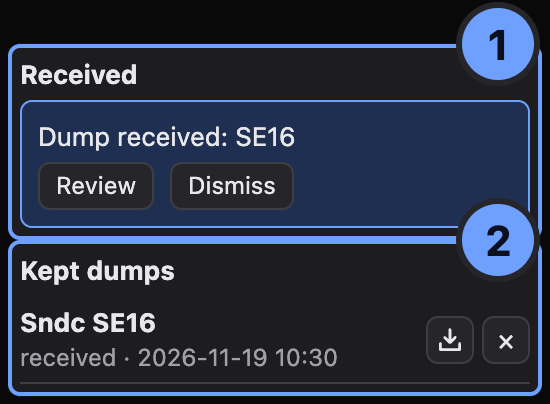
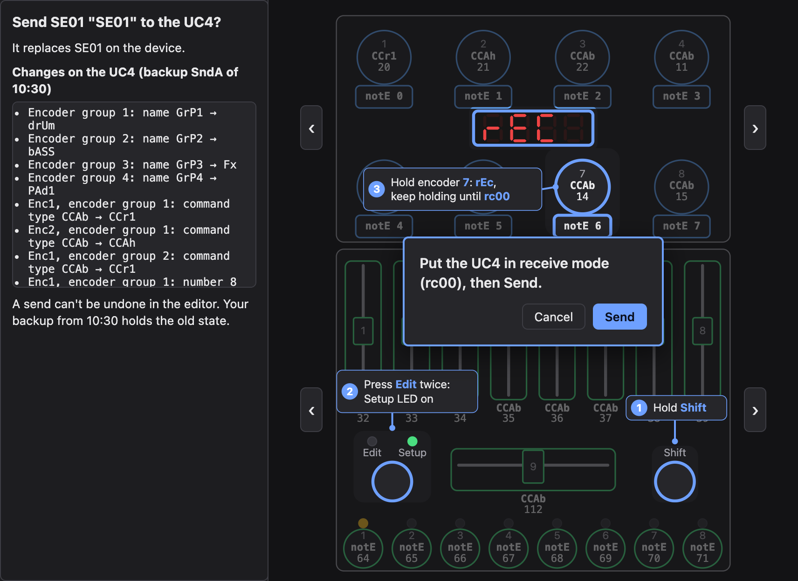

# From and to the UC4

!!! warning "Sending overwrites a setup on the UC4"
    A send replaces the setup in that slot on the UC4. The editor cannot undo it. **Before you send,
    press `SndA` on the UC4 so the editor keeps a backup of all 18 setups.** Connect the editor first,
    then press `SndA`. Only a `SndA` received since you connected counts. After a reconnect, press it
    again. How to do that is [below](#make-a-snda-backup). With that backup the editor can put the old
    setup back ([Restore](#restore)).

Only you operate the UC4. The editor never presses anything on it. It listens, and it sends only
when you press **Send** or **Restore** and then confirm.

## Connect first

Open **Connections** and connect the UC4. See [Getting started](getting-started.md#connect-the-uc4).

## Receive from the UC4

The UC4 sends its setups as *dumps*. A dump holds one setup (`Sndc`) or all 18 (`SndA`).

### Make a `SndA` backup

1. With the editor connected, hold `Shift` on the UC4 and press `Edit` twice. This is setup mode,
   and the Setup LED is lit.
2. Hold the push button of **encoder 8** until the bars have run (`Sn00` to `Sn99`). The UC4 sends
   all 18 setups: `SndA`.
3. `Shift` aborts.

### Send one setup (`Sndc`)

1. On the UC4, hold `Shift` and press `Edit` twice (setup mode, Setup LED lit).
2. Turn **encoder 1** to the setup you want to send (`SE01` to `SE18`).
3. Hold the push button of **encoder 4** until the bars have run. The UC4 sends that setup: `Sndc`.
4. `Shift` aborts.

These steps are also in **Connections**, under *How to send a dump from the UC4*.

### What the editor does with it

A dump can arrive at any time while the UC4 is connected. The editor **never changes your work
because a dump arrived**:

- The strip at the left pulses and shows a count, and the help line shows *Dump received: open
  Connections*. Connections does not open by itself.
- In Connections, under **Received**, the dump waits as a dump notice. **Review** asks what to do with it:
  a `Sndc` goes to its slot (you are asked whether to replace the setup there or to choose another
  slot), a `SndA` asks whether to replace the whole library. **Dismiss** drops only the dump notice. You
  can undo an import with `Cmd`+`Z`.
- Every dump is **kept** as it came, with its date, whether you review it or not. The list
  **Kept dumps** shows the newest first. A row has an *Export .syx* button and `×` to
  delete it; deleting asks first and cannot be undone. **Clear old dumps…** keeps the newest of each
  kind and slot, and every dump a setup still needs.
- A setup that came from a dump remembers it. **Revert to its dump…**, under the setup list, takes
  back every edit since then, and **Undo** brings the edits back.
- A dump the editor cannot read is kept too. The dump notice says *Dump received but unreadable* with the
  reason, and offers **Export**, so you still have the bytes.
- A value in a dump that the editor cannot read is shown as the factory value and marked as a
  problem. It is never silently changed.

1. **Received:** the dump waits as a dump notice, here a `Sndc` of `SE16`. **Review** opens the question
   what to do with it. **Dismiss** drops only the dump notice.
2. **Kept dumps:** the same dump, kept as it came, with when it was received. The *Export .syx* button
   exports it as a `.syx` file. `×` deletes it, after asking.

## Send to the UC4

!!! warning "Overwrites the setup in that slot"
    Make a `SndA` backup first, as described above. A send needs the UC4 to be connected and in receive
    mode (`rEc`). The editor sends over USB, so make sure nothing else, such as another
    program or a cable into the UC4's MIDI in, sends to the UC4 at the same time.

**Send SE05 to UC4…** is under the setup list (with the number of the selected setup). It is grey
until the UC4 is connected, and it only opens a dialog. The editor sends **one setup into its own
slot**. Sending all 18 setups is not available.

!!! note "What has been tried (as of November 2026)"
    Sending has been tested on the real UC4 (firmware 02.05) with setup `SE16`. Other slots are built
    the same way but have not been tested on the device yet.

### The Send dialog

The dialog sits beside the device view and says:

- **What it does:** *Send SE05 "name" to the UC4?* and *It replaces SE05 on the device.*
- **What changes**, in the UC4's own words, for example `Encoder group 1: name GrP1 → SEnd`. At most 8
  lines are shown, then *+ n more*. *No changes* appears when the setup is the same as what it is
  compared with.
- **What it is compared with:** the last `SndA` backup you received since you connected, or else the
  `Sndc` the setup came from, or else the factory setup of that slot. The title says which.
- **The backup:** *Your backup from 01:41 holds the old state.* Without a `SndA`, it says *No backup
  from the UC4: the old SE05 can't be restored. Press SndA first if you want one.* A send without a
  backup is possible.

The editor writes only the values whose place in the dump is known. If a value it cannot write
differs from the dump it is compared with (see above), the dialog refuses the send, says which value,
and sends nothing.
See [How it works](how-it-works.md).

### Put the UC4 in receive mode

When the dialog is open, the drawn UC4 is dimmed except the places the notes point at, with three numbered notes:

1. Hold `Shift`.
2. Press `Edit` twice: the Setup LED is on.
3. Hold **encoder 7** (its push button): the display shows `rEc`. Keep holding until it shows `rc00`.

The dialog at the left lists the changes. The card in the middle of the drawn UC4 says *Put the UC4 in
receive mode (rc00), then Send.* with **Cancel** and **Send**. Press **Send** only when the UC4 shows
`rc00`. The UC4 does not report anything back that the editor can see.

`Esc` or **Cancel** closes the dialog, and nothing is sent.

### What the UC4 shows

| Display | Meaning |
| --- | --- |
| `rEc`, `rc00` | The UC4 is ready to receive. |
| `SE05` (the slot) | The setup is stored. |
| `Err` | A record of the dump was damaged. |

After a send the editor shows one line under the button: *Sent SE05. The UC4 shows SE05 when it's
stored. If it shows Err, SE05 may be half written: send again.*

The UC4 checks a sum for every record of a dump. A record with a wrong sum is **not stored**, but the
records before it **are**. After `Err`, the setup can be half written, so **send again**. A second send
writes every record again.

If you press `Sndc` on the UC4 afterwards and the setup is the same as what you sent, the editor says
*SE05 on the UC4 matches the editor* instead of showing a new dump notice.

## Restore

**Restore SE05…** appears under the **Send** button once you have sent that slot. It puts the **old**
setup back on the UC4, taken from the backup `SndA` your send named. The editor's own setup stays as
it is.

1. Press **Restore SE05…**. The dialog says *Restore SE05 from the backup SndA of 01:41?* and lists
   the changes.
2. Put the UC4 in receive mode with the same three notes as for a send.
3. Press **Restore** when the UC4 shows `rc00`.

The editor then shows *Restored SE05 from the backup. The UC4 shows SE05 when it's stored. If it shows
Err, SE05 may be half written: restore again.* If there is nothing to restore from, the dialog says so
and sends nothing. That happens, for example, when the send had no backup, or when its backup was
deleted under **Kept dumps**.
