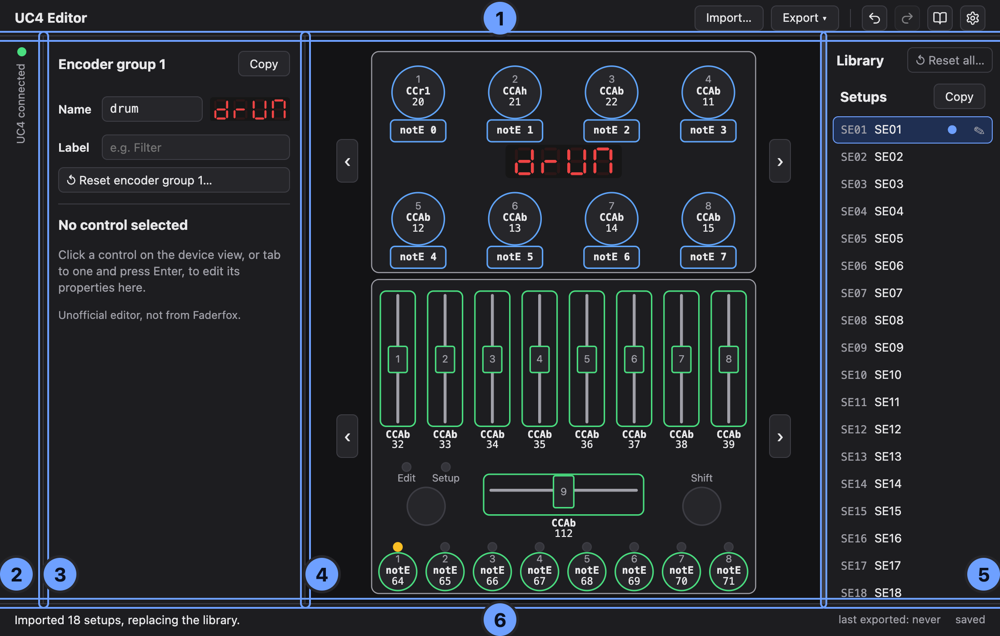
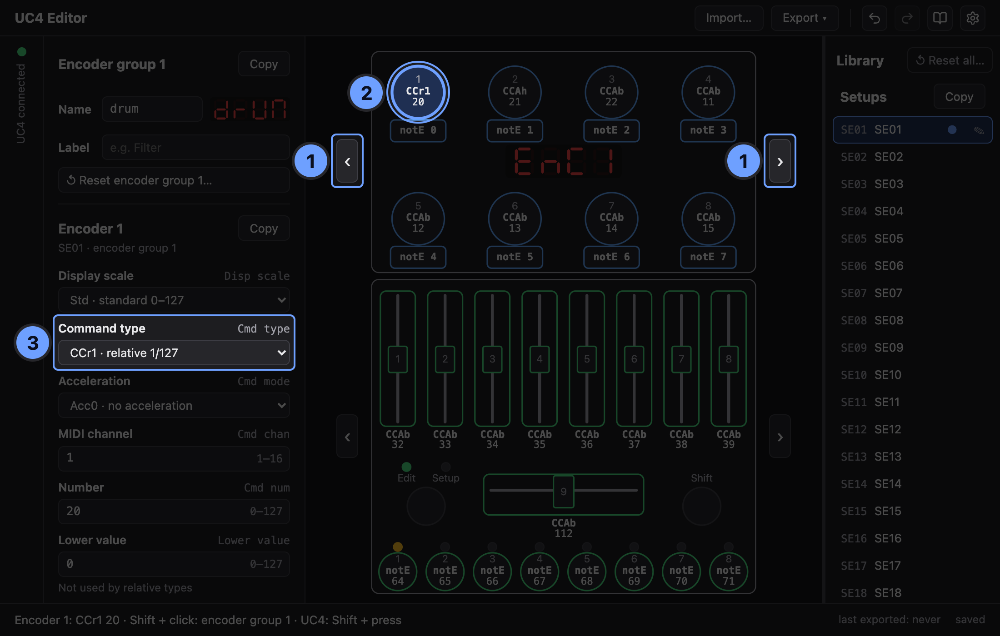

# The editor

This page walks through the editor window. The editor changes the setups in your browser. It never
changes the UC4 by itself: to put a setup on the UC4 you use
[From and to the UC4](device.md).

!!! warning "Sending overwrites setups"
    The **Send** button under the setup list replaces a setup on the UC4. Make a `SndA` backup of all
    18 setups first. [From and to the UC4](device.md) shows how.

## The six areas

The editor window has six areas. The numbers in the picture match the sections below.

### 1. Toolbar

Import opens a configuration (.json) or a dump (.syx) from your computer, and Export saves the library.
Undo and redo step back and forward through your changes.
The book opens the user guide; the gear opens Settings. More in [Files](files.md).

### 2. Connections

This column shows whether the UC4 is connected and holds the dumps it sent, with Review, Export and Dismiss.
It only listens: the editor sends nothing to the UC4 until you press Send. More in
[Getting started](getting-started.md).

### 3. Property panel

Here you edit the group names and, once you select a control, its properties.
It shows only the properties that control kind has, in the UC4's own words, such as CCr1 or SnAP.
More in [Change a property](#change-a-property).

### 4. Device view

The drawn UC4 shows the selected setup. Click a control to edit it.
The arrows step through the 8 encoder groups and the 8 fader/button groups, each on its own, as on the device.
More in [The two group selections](#the-two-group-selections).

### 5. Setup list

The 18 setups of the library, named SE01 to SE18 like the UC4's slots. Click one to show it on the device view.
Rename, copy and paste setups here, and send one to the UC4 with Send. More in [Pick a setup](#pick-a-setup).

### 6. Help line

The line at the bottom says what is under the mouse or in focus.
It also shows messages, such as a value that was refused and what to do about it.

## The window

In this guide `Cmd` means the `Cmd` key on a Mac and the `Ctrl` key on Windows and Linux.

1. **The encoder group selection.** The arrows `‹` and `›` next to the upper block step through the
   8 encoder groups. The fader/button groups have their own arrows below.
2. **An encoder.** Click a control to edit it.
3. **A property.** The selected control's properties are listed in the panel on the left. This one is
   the command type.

The six areas of the window are described in [The six areas](#the-six-areas). Files are covered in
[Files](files.md).

## Pick a setup

Click a setup in the list on the right. The device view shows it. The setup list uses the UC4's own
slot names, `SE01` to `SE18`.

To rename a setup, press `F2` or click the pencil. Press `Enter` to keep the name, `Esc` to leave it
as it was. The name is kept in the editor. It is **not** written to the UC4, which has no setup names.

## Pick a control

The device view has the UC4's controls: 8 encoders with their push buttons, 9 faders and 8 green
buttons. Click one. It is now selected, the **Edit LED** lights up (as on the UC4 in edit mode), and
the property panel shows its properties.

To leave edit mode, press `Esc` or click an empty place in the device view.

## Change a property

Each property shows the editor's plain name and, at the right, the word the UC4 shows for it:

| Plain name | On the UC4 | Values |
| --- | --- | --- |
| Display scale (green buttons: LED) | `Disp scale` | a choice; push buttons have none |
| Command type | `Cmd type` | a choice, for example `CCAb`, `CCr1`, `CCAh`, `notE` |
| Acceleration (encoders), Button mode, Fader mode | `Cmd mode` | a choice, for example `Acc0`–`Acc3`, `btn`, `toGL`, `JMP`, `SnAP` |
| MIDI channel | `Cmd chan` | 1–16 |
| Number | `Cmd num` | 0–127 |
| Lower value | `Lower value` | 0–127 |
| Upper value | `Upper value` | 0–127 |

Which properties and choices you see depends on the kind of control. A value the UC4 would not accept
is marked in red, and the help line shows the problem count at its right. The arrows next to the count step through
them.

Every change is saved in your browser at once. **Undo** (`Cmd`+`Z`) takes back
the last change.

## The two group selections

A setup has **8 encoder groups** and **8 fader/button groups**. They are selected **independently**, as
on the UC4: the upper arrows change the encoder group, the lower arrows change the fader/button group.

- Keys: `(` `)` for the encoder group, `{` `}` for the fader/button group.
- With a control selected, `Option` + `←` `→` steps the group of that control.
- `Shift` + click on encoder *n* selects encoder group *n*. `Shift` + click on green button *n*
  selects fader/button group *n*. This is what `Shift` + press does on the UC4.

At the top of the property panel is the group you work in.

**An encoder group** has:

- a **Name** of 4 characters, shown on the drawn display. The UC4's display can only show some
  characters, and the editor tells you which ones it cannot show.
- a **Label**, a longer note for yourself, for example "Filter". The editor suggests a name made from
  the label with characters the display can show.

**A fader/button group** has no name. It has a **Label**, and the LED above the green buttons shows
which group is selected.

## Settings

The gear (or `Cmd`+`,`) opens Settings: the theme (light, dark or your computer's setting), the keys
(Standard, or Vim, which adds `y` to copy and `p` to paste) and the slide speed. `?` shows all keys;
the full table is on [Keys](keys.md).
