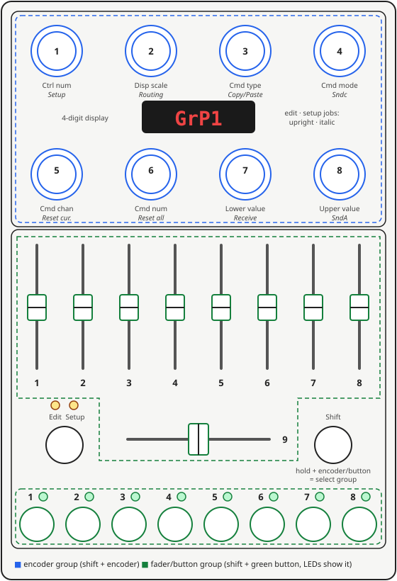
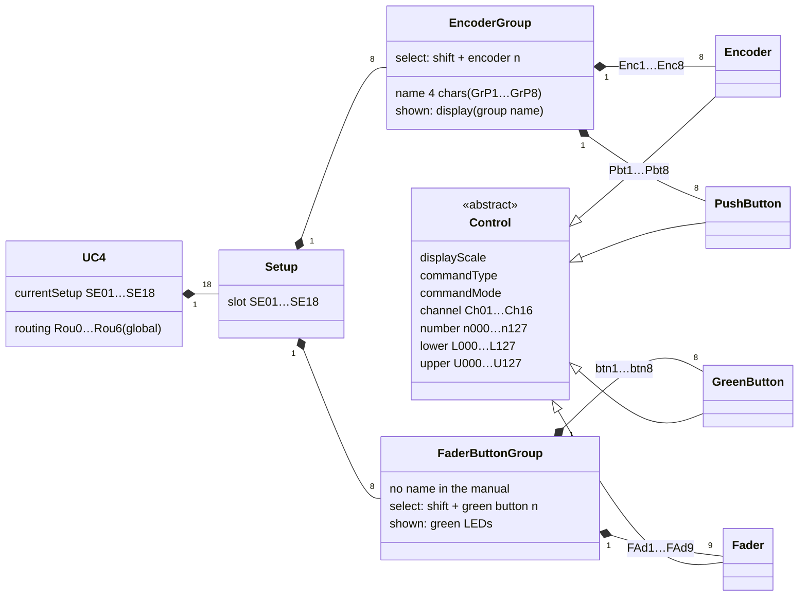

# Faderfox UC4 — device facts

Everything the editor needs from the UC4 user manual (version 3, from
<https://www.faderfox.de/uc4.html>; the PDF is Faderfox's and not kept in this repo), in one place. Owned by the architect. A fact not in this file is not known; ask before assuming it.
The manual does **not** describe the SysEx dump format — that is `docs/protocol/uc4-sysex.md`.

## Controls

| Kind | Count | Device name in edit mode | Belongs to |
|---|---:|---|---|
| Encoder (push encoder, no detents, ~36 pulses) | 8 | `Enc1`…`Enc8` | encoder group |
| Encoder push button | 8 | `Pbt1`…`Pbt8` | encoder group |
| Green button (with LED) | 8 | `btn1`…`btn8` | fader/button group |
| Fader | 9 | `FAd1`…`FAd9` | fader/button group |

- **Two independent group selections**, 8 groups each: the **encoder group** (shift + encoder 1–8,
  display shows the group name) and the **fader/button group** (shift + green button 1–8, the green
  LEDs show it). E.g. encoder group 3 and fader/button group 6 at the same time.
- 33 controls × 8 groups = 264 commands per setup.
- **Group names**: 4 characters, one per *encoder* group, per setup (edited with shift + encoders
  1–4 in edit mode; default `GrP1`…`GrP8`). The manual names no fader/button group names.
  The character list (user, 2026-11-13; codes from dump session 1 batches 8/8b): digits `0`–`9`,
  then the letters `a b c d e f g h i j l m n o p q r s t u x y z` (no `k`, no `w`, one sign for
  `u`/`v`), then 6 symbols: `-` (middle segment), `_` (bottom), `'` (upper left), `"` (upper left
  + upper right), `=` (bottom + middle, code 25), and blank (all segments off). On the 7-segment display `z` looks
  like `2` and `x` like `H`; `u`/`v` is a big `U` (user, 2026-11-15). Every other letter looks
  as the editor draws it (user, 2026-11-15, milestone 1 letter check).
- **18 setups** (`SE01`…`SE18`). Setups 17 and 18 are preconfigured for Ableton Live 8/9 (tracks
  1–8 and 9–16).
- 4-digit display, 8 LEDs; a display point flashes on incoming MIDI.
- **Firmware**: the user's UC4 shows `02.05` at power-on, the latest on faderfox.de (2026-11-13).
  Firmware updates are `.syx` files too (`UC4 V0205.SYX`): the editor must tell a firmware file
  from a setup dump and never send one.

### Panel layout

Our own schematic: [uc4-panel.svg](uc4-panel.svg), drawn from Faderfox's front-panel drawing
(2026-11-13; that drawing is not in the repo). Blue: encoder group, green: fader/button group;
under each encoder its edit-mode job, in italics its setup-mode job. The SVG's element ids
(`enc1`…`enc8`, `fader1`…`fader9`, `btn1`…`btn8`, `display`, `edit`, `shift`) are what the device
view and the device how-to build on.

- Top: encoders 1–4, then the display row (Ableton labels left/right of the display), then
  encoders 5–8. Each encoder is printed with its edit-mode and setup-mode function: 1 `Ctrl num` /
  `Setup`, 2 `Disp scale` / `Routing`, 3 `Cmd type` / `Copy/Paste`, 4 `Cmd mode`, 5 `Cmd chan` /
  `Reset cur.`, 6 `Cmd num` / `Reset all`, 7 `Lower value` / `Receive`, 8 `Upper value`.
- Middle: faders 1–8 (vertical), below them **fader 9, horizontal** (crossfader).
- Left of fader 9: the **Edit/Setup** button with two LEDs (`Edit`, `Setup`). Right: **Shift**,
  printed "hold shift and press encoder or key to select group".
- Bottom: green buttons 1–8, each with its LED above it.
- `Midi out` / `Midi in` jacks on the top edge.

### Printed Ableton names (SE17/SE18)

From a photo of the panel (user, 2026-11-14; the photo itself is not in the repo). The large
names name the **groups** of the Ableton setups, not single controls: shift + encoder n / green
button n selects the group printed there. They match the factory encoder group names.

| n | Encoder group n (under encoder n) | Factory name | Fader/button group n (above green button n) |
|---|---|---|---|
| 1 | Send 1 | `Snd1` | Launch |
| 2 | Send 2 | `Snd2` | Stop |
| 3 | Send 3 | `Snd3` | Active |
| 4 | Send 4 | `Snd4` | Solo |
| 5 | Track | `traC` | Record |
| 6 | Rack | `rAC` | Monitor |
| 7 | Pan | `PAn` | Track |
| 8 | Global | `GLOb` | Select |

Two boxes beside the display, marked "Global" (encoder group 8), print the Global group's
functions. Left: `coarse Tempo fine`, `nudge ∨ ∧ nudge`, `play – global – stop`, `Track Cue`.
Right: `Quant Scene`, `stop – scene – start`, `record – global – view`, `Pan Master`. **Which
encoder or push button each one is, is not known** (open; for the user's look list).

The photo's display shows `Ed1t`: the letter `i` is drawn like `1` (segments b and c).
Looked at on the device (user, 2026-11-14, SE17 groups 5–8): `a` is the big `A` (`trac` and `PAn`
share code `0A` in the factory dump), `l` the big `L`, `o` the big `O` (all four sides, like `0`).

### Structure

What a group selection selects (user checked it against the manual, 2026-11-13). The green LEDs,
not the display, show the fader/button group, which is why shift + green button shows no `GrPn`.

Per setup: 8 × (8 + 8) encoder-group controls + 8 × (8 + 9) fader/button-group controls = 264
commands. At any moment the device plays one encoder group and one fader/button group, chosen
independently.

To confirm on the device: which group's controls edit mode shows (the selected one of each kind?),
and what the display shows on entering edit mode and setup mode.

## Properties per control (edit mode)

Encoder 1 picks the control, encoders 2–8 set its properties. `----` on the display means the
property doesn't exist for this control.

| Property | Edit encoder | Encoder | Push button | Green button | Fader |
|---|---|---|---|---|---|
| Display scale | 2 | `OFF` `Std` `bPoL` | — ¹ | `OFF` `Std` `EXt` (LED) | `OFF` `Std` `bPoL` |
| Command type | 3 | `CCr1` `CCr2` `CCAb` `PrGC` `CCAh` `Pbnd` `AFtt` | `OFF` `notE` `CC` `PrGC` `AFtt` | `OFF` `notE` `CC` `PrGC` `AFtt` | `CCAb` `PrGC` `Pbnd` `AFtt` |
| Command mode | 4 | `Acc0` `Acc1` `Acc2` `Acc3` | `btn` `toGL` | `btn` `toGL` | `SnAP` `JMP` |
| Channel | 5 | `Ch01`…`Ch16` | same | same | same |
| Number | 6 | `n000`…`n127` | same | same | same |
| Lower value | 7 | `L000`…`L127` | same | same | same |
| Upper value | 8 | `U000`…`U127` | same | same | same |

¹ Push buttons have no display scale: edit encoder 2 shows `----` on `Pbt1` (user, 2026-11-13).
The dump still has a display nibble per push button (non-zero in the user's SE02); the decoder keeps
it raw.

### What the display shows in edit mode

For the editor's display (0006 decision 26), from the table above and the manual:

- Turning edit encoder 1 shows the picked control: `Enc1`…`Enc8`, `Pbt1`…`Pbt8`, `btn1`…`btn8`,
  `FAd1`…`FAd9`.
- Turning edit encoders 2–8 shows that property's value: the code (`Std`, `CCAb`, `Acc3`, `toGL`,
  `JMP`, …), `Ch01`…`Ch16`, `n000`…`n127`, `L000`…`L127`, `U000`…`U127`.
- `----`: the property doesn't exist for this control (push button display scale).
- The editor maps this as: a focused property shows its value in that form; a selected control
  with no property focused shows its name.

To check on the device (look only, user's look list): what the display shows right after entering
edit mode, whether a value stays on the display or falls back to the group name after a while,
and whether touching an edit encoder without turning it shows the value.

### Values

- Display scale — `OFF` none; `Std` 0…127 by the device and external commands; `bPoL` bipolar
  −63…63. Green button: `OFF` no LED control; `Std` LED by device and external command; `EXt` LED
  only by external commands (feedback with the same command as the button).
- Command type — `CCr1` CC relative mode 1 (values 1/127); `CCr2` CC relative mode 2 (63/65);
  `CCAb` CC 7-bit absolute 0…127; `PrGC` program change 0…127; `CCAh` two CCs MSB/LSB, 14-bit
  0…16383; `Pbnd` pitch bend 14-bit 0…16383; `AFtt` channel aftertouch 0…127; `notE` note; `CC`
  control change (buttons); `OFF` sends nothing. Buttons: upper value = press/on, lower = release/off.
  **In a DAW** (for the help line, 0006 decision 29): `CCr1` sends 1 for up and 127 for down
  (two's complement; Ableton "Relative (2's Comp.)"); `CCr2` sends 65 for up and 63 for down
  (binary offset, 64 = no change; Ableton "Relative (Binary Offset)"). Relative formats aren't
  standardised: if an encoder turns the wrong way, the DAW mode with the opposite sign is the fix.
  `CCAh`: number 0–31 is the coarse CC, number + 32 the fine one; few programs read it. Sources
  (2026-11-15): Ardour manual "Working with encoders"
  (manual.ardour.org/using-control-surfaces/generic-midi/working-with-encoders/), Cantabile
  "Controller encoding" (cantabilesoftware.com/guides/controllerEncoding), Serato "MIDI data types"
  (support.serato.com/hc/en-us/articles/225065768), Ableton "Making custom MIDI mappings"
  (help.ableton.com/hc/en-us/articles/360000038859); the direction of `CCr2` is from the manual's
  "63/65" read as binary offset.
  Encoder type order on the display (edit encoder 3), noted by the user on the device,
  2026-11-13: `CCr1 CCr2 CCAb PrGC CCAh Pbnd AFtt`, the manual's order.
  Green button type list on the display (user, on the device, 2026-11-13): `notE CC PrGC AFtt`,
  **no `OFF`**, although the manual lists `OFF` for green buttons too. The push button list does
  start with `OFF` (dump session 1, `Pbt1` → `OFF`).
- Command mode — `Acc0`…`Acc3` no/low/middle/max acceleration (shift while turning = no
  acceleration). `SnAP` sends only after catching the last value; `JMP` sends at once (shift while
  moving swaps temporarily). `btn` momentary; `toGL` toggle.
- Number — 0…127 for note and CC. With `CCAh` 0…31 is the MSB; the LSB is number + 32 automatically.
- Lower/upper — 0…127, not for relative types. Lower > upper inverts the control. Same lower and
  upper on a `PrGC` button sends one program number.

### Edit-mode helpers (device only, for reference)

- Hold the push button of encoder 2, 3, 4, 5, 7 or 8 → copy that property to all controls of the
  same group.
- Hold encoder 6 → MIDI learn of number, channel and type.

## Setup mode

Shift + edit twice. Hold the encoder push button while bars run to start a function.

| Encoder | Function |
|---|---|
| 1 | `SE01`…`SE18` select setup |
| 2 | Routing `Rou0` none · `Rou1` USB in → MIDI out · `Rou2` MIDI in → MIDI out · `Rou4` MIDI in → USB out · `Rou5` MIDI in → USB out + USB in → MIDI out · `Rou6` MIDI in → MIDI out + MIDI in → USB out (no `Rou3`) |
| 3 | Copy/paste: `CPYS`/`PStS` setup, `CPYn`/`PStn` group name, `CPYE`/`PStE` encoders, `CPYP`/`PSTP` push buttons, `CPYF`/`PSTF` faders, `CPYb`/`PSTb` buttons |
| 4 | `Sndc` send the selected setup as SysEx (USB and MIDI out) |
| 5 | `rESc` reset the selected setup to factory data |
| 6 | `rESA` reset all setups to factory data |
| 7 | `rEc` receive one or all setups (`rc00`…`rc99` progress, `SE..` done, `Err` error; shift aborts) |
| 8 | `SndA` send all setups (`Sn00`…`Sn99` progress, shift aborts) |

- Receive: put the device in `rEc`, then send the dump. **Never send to USB and MIDI in at the same
  time.** A received dump is stored at once: it overwrites setups.
- Routing is a global setting (factory: `Rou6`); whether it is part of a dump is unknown.
- **No remote control of setups or groups** (Faderfox, 2026-11-25): the UC4 cannot be switched to another setup or
  group by MIDI or SysEx, and it sends nothing when the setup or group is changed on the device. (Only the EC4 has
  that.) A remote script sees the UC4 only through the controls' own messages and can drive values and LEDs
  (`Std`/`EXt`) in the group shown on the device.
- **Port name** as the OS lists it: `Faderfox UC4` (`receivemidi list`, 2026-11-15, macOS). The
  editor finds the device by this name (0005 step 3).
- **Sending a dump from the device**, in the editor's words (0005 decision 7): hold Shift and press
  Edit twice (setup mode, Setup LED lit); turn encoder 1 to the setup; hold encoder 4's push button
  until the bars have run (`Sndc`, one setup). For all 18 setups hold encoder 8 instead (`SndA`,
  `Sn00`…`Sn99`). Shift aborts.

## Factory settings

Setups 1–16: channel = setup number. Setups 17/18 (Ableton): channel 13 or 14 as listed
(`13/14` = 13 in setup 17, 14 in setup 18).

| | Setups 1–16 | Setups 17/18 |
|---|---|---|
| Encoders | `Std`, `Acc3`, `CCAb` | `Std`, `Acc3`, `CCAb` |
| Push buttons | `btn`, `notE` | `btn`, `notE` |
| Green buttons | `Std`, `btn`, `notE` | `EXt`, `btn`, `notE` |
| Faders 1–8 | `Std`, `JMP`, `CCAb` | `Std`, `SnAP`, `CCAb` |
| Fader 9 | `Std`, `JMP`, `CCAb`, CC112 in all groups | CC048, channel 14 in both |

Numbers per group (1…8):

| | G1 | G2 | G3 | G4 | G5 | G6 | G7 | G8 |
|---|---|---|---|---|---|---|---|---|
| Encoder CC, 1–16 | 008–015 | 016–023 | 024–031 | 032–039 | 072–079 | 080–087 | 088–095 | 096–103 |
| Encoder CC, 17/18 | 000–007 | 008–015 | 016–023 | 024–031 | 056–063 | 048–055 | 032–039 | 056–063 |
| Encoder ch, 17/18 | 13/14 | 13/14 | 13/14 | 13/14 | 14/14 | 13/14 | 13/14 | 13/13 |
| Push note, 1–16 | 000–007 | 008–015 | 016–023 | 024–031 | 032–039 | 040–047 | 048–055 | 056–063 |
| Push note, 17/18 | — | — | — | — | 122–123 | — | — | 120–127 |
| Push ch, 17/18 | — | — | — | — | 14/14 | — | — | 13/13 |
| Button note, 1–16 | 064–071 | 072–079 | 080–087 | 088–095 | 096–103 | 104–111 | 112–119 | 120–127 |
| Button note, 17/18 | 064–071 | 072–079 | 104–111 | 096–103 | 080–087 | 088–095 | 120–127 | 056–063 |
| Button ch, 17/18 | 13/14 | 13/14 | 13/14 | 13/14 | 13/14 | 13/14 | 14/14 | 13/14 |
| Fader CC, 1–16 | 032–039 | 040–047 | 048–055 | 056–063 | 104–111 | 104–111 | 104–111 | 104–111 |
| Fader CC, 17/18 | 040–047 | 040–047 | 040–047 | 040–047 | 040–047 | 040–047 | 040–047 | 040–047 |
| Fader ch, 17/18 | 13/14 | 13/14 | 13/14 | 13/14 | 13/14 | 13/14 | 13/14 | 13/14 |
| Encoder group name, 1–16 | `GrP1` | `GrP2` | `GrP3` | `GrP4` | `GrP5` | `GrP6` | `GrP7` | `GrP8` |
| Encoder group name, 17/18 | `Snd1` | `Snd2` | `Snd3` | `Snd4` | `traC` | `RAC` | `PAn` | `GLOb` |

SE18 encoder group 6: the manual prints channel 13/14, but the factory data has **channel 13** for
all 8 encoders and all 8 push buttons of group 6 (like group 8, `13/13`): a typo in the manual.
Confirmed by an `SndA` after `rESA` (2026-11-13, `dumps/2026-11-13-SndA-after-rESA.syx`), which
differs from the user's backup only in the user's own edits (SE01 1 byte, SE02 130 bytes).

Not in the manual's table, read from the factory `SndA` (`dumps/2026-11-13-SndA-after-rESA.syx`,
uc4-model, 2026-11-13). Fields read through dump fields that are still `likely` (push display;
type and mode of controls other than 1 and 8) stay `likely` until 0004 decodes the dump:
- Lower/upper 0/127 everywhere, except below.
- Setups 17/18:
  - Push buttons printed `----` are type `OFF`, lower 0, upper 0, with the encoder number and
    channel of their group. Group 5 push 3/4 are `notE` 122/123; group 8 push 1–8 `notE` 120–127;
    group 7 push buttons have lower 64, upper 64.
  - Encoders: group 5 encoders 4/5 and group 8 encoders 1, 2, 4, 5 are `CCr1` `Acc0`; group 5
    encoders 6/7 and all of group 7 have display `bPoL`.
  - Group 7 green buttons are numbered 123 122 127 126 124 125 120 121 (in this order).
  - Fader 9: `JMP`, `Std`, CC 48, channel 14, lower 0, upper 127.
  - Group names in the dump: `snd1 snd2 snd3 snd4 trac rac_ pan_ glob` (`_` = trailing blank).
- Still open: the encoder G5/G8 overlap with G6 in 17/18 (056–063 twice), as printed.

General (only changed by `rESA`): current setup 01, routing `Rou6`.

## Connections

USB class compliant (bus powered), MIDI in/out on 3.5 mm jacks with adapter cables. A dump goes out
on USB and MIDI at once.
